# 3D Art Works 2023

**English** | [中文](README.zh-CN.md)

An early art showreel from September 2023. I made it while studying for an Associate Degree in Digital Media Technology (Nanhu College, Shanghai) and applying for game-art roles. It is kept here for anyone who wants to see the visual side of my background. There is no programming in it.

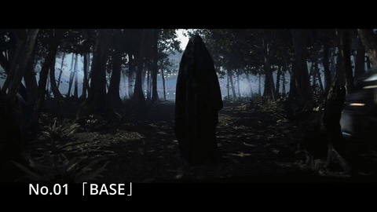

**[Watch the reel](https://zeeekrom.github.io/3d-art-works-2023/reel/)** (2 min, with music)

## What is in the reel

The numbers are the ones shown on screen. They come from a longer list of works, and the reel shows a selection.

| Time | Title in the reel | What it shows |
|---|---|---|
| 0:03 | No.01 BASE | A dark forest environment |
| 0:07 | No.02 Lost Lion Civilization | Ruins by firelight, followed by further environment shots: a forest shrine and a forest with a giant creature |
| 0:33 | No.03 Cyberpunk City | A city scene |
| 0:35 | No.04 Armed Deerslayer | A stylised character with a weapon |
| 0:41 | No.05 Full Process of Producing Cartoon Character | A cartoon character taken through the stages of production |
| 0:47 | No.06 Billboard | A hard-surface prop |
| 0:52 | No.15 Motion Captured Animation (UE5) | Motion-capture animation on characters in Unreal Engine 5 |
| 1:13 | No.12 Shuttle Back and Forth | A space-travel effect |
| 1:17 | No.23 Assault Rifle | A hard-surface weapon model |
| 1:20 | AI images | Images generated with Stable Diffusion |
| 1:41 | No.19 ControlNet | Stable Diffusion with ControlNet, with models compared side by side |

## Stills

| | | |
|---|---|---|
| 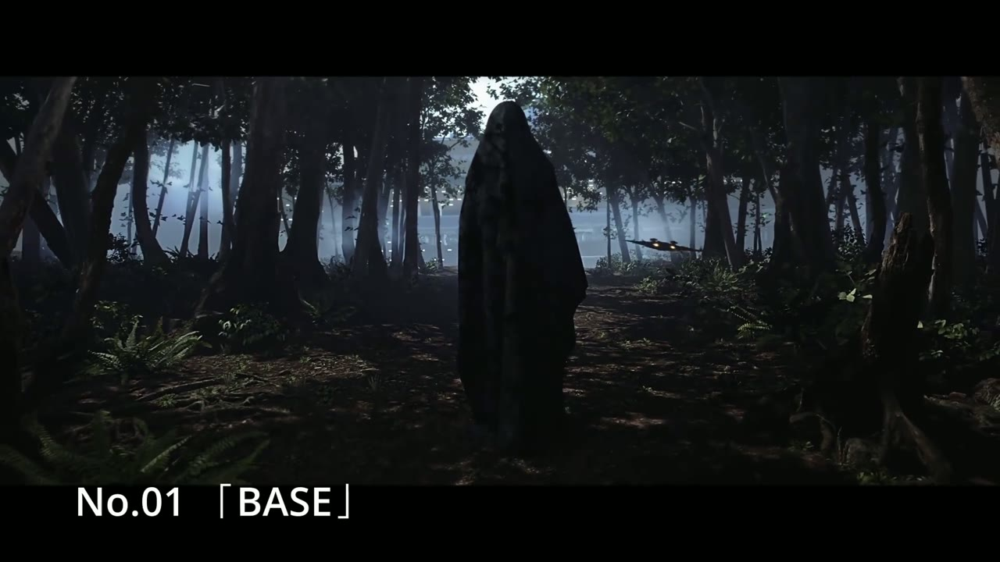 | 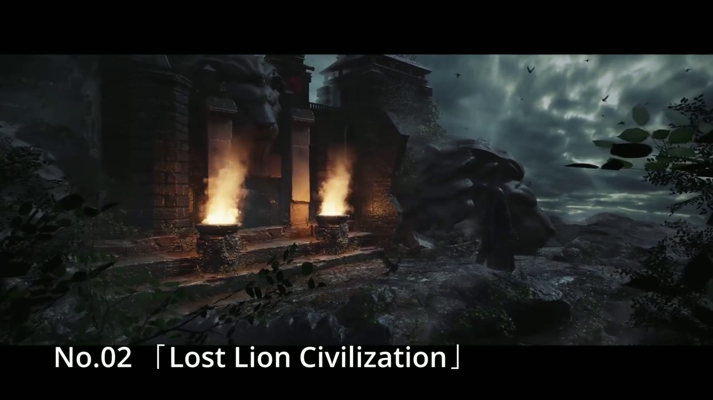 | 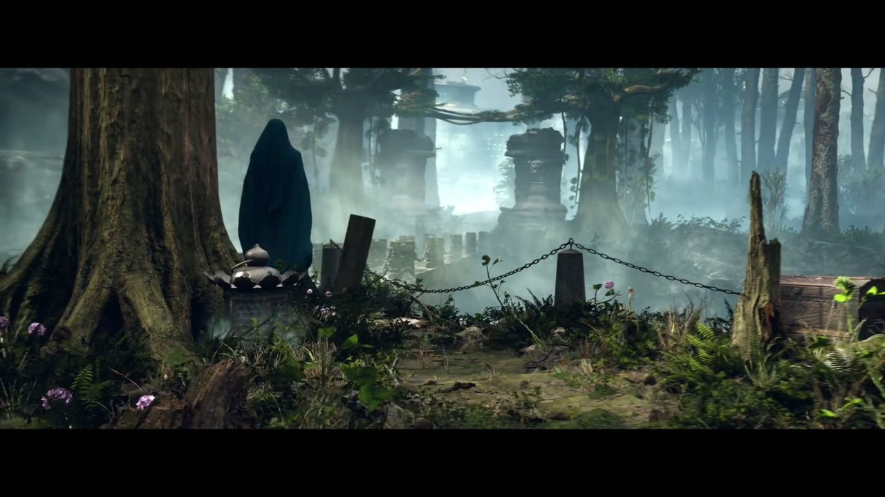 |
| No.01 BASE | No.02 Lost Lion Civilization | Forest shrine |
| 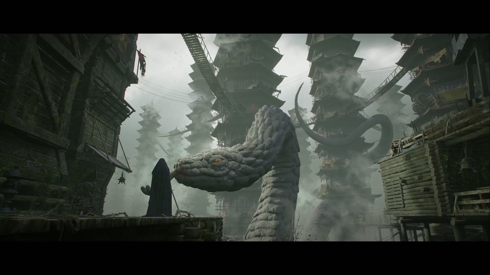 | 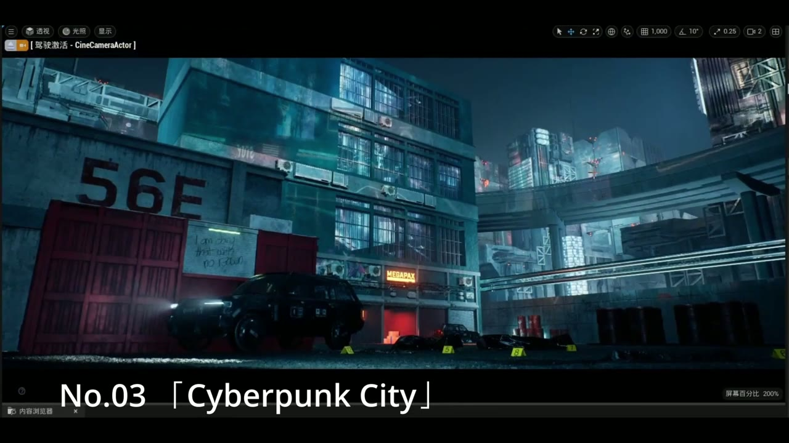 | 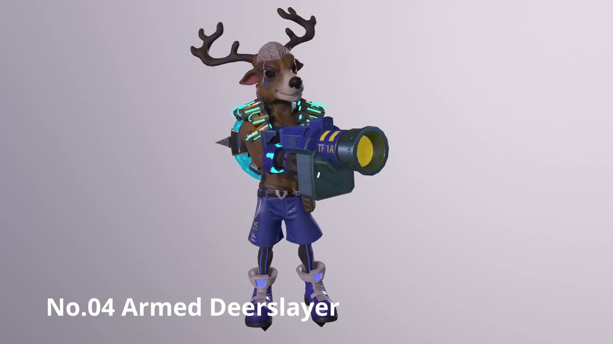 |
| Forest with a giant creature | No.03 Cyberpunk City | No.04 Armed Deerslayer |
| 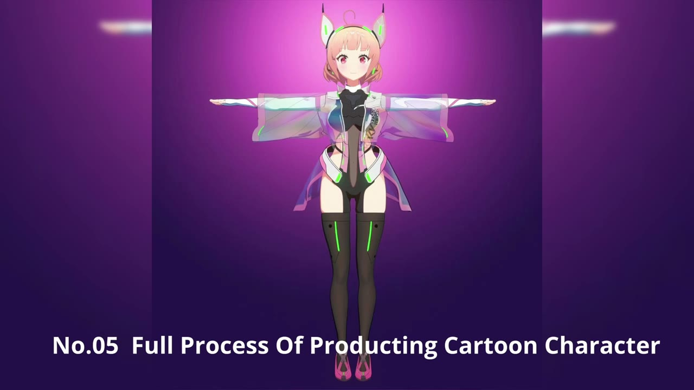 | 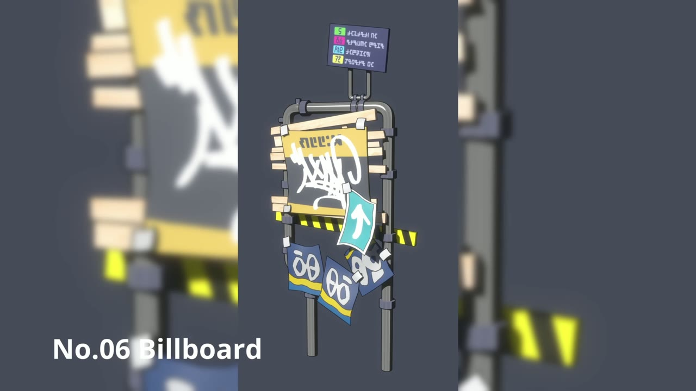 | 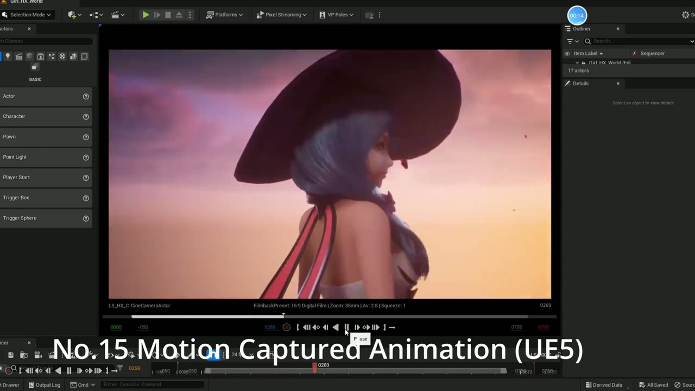 |
| No.05 Cartoon character | No.06 Billboard | No.15 Motion-captured animation |
| 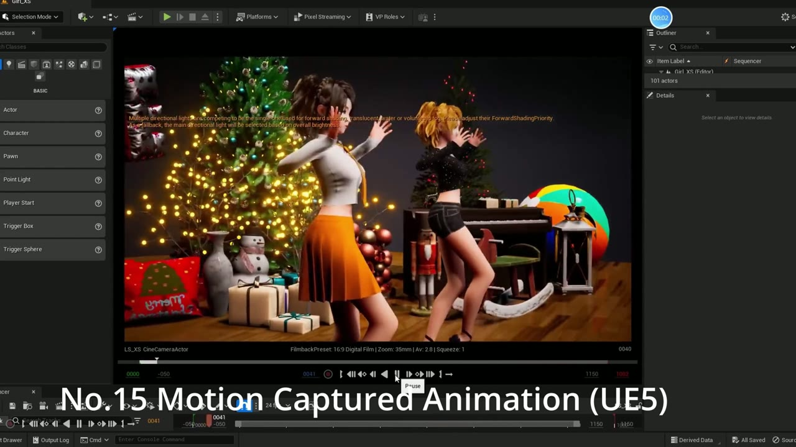 | 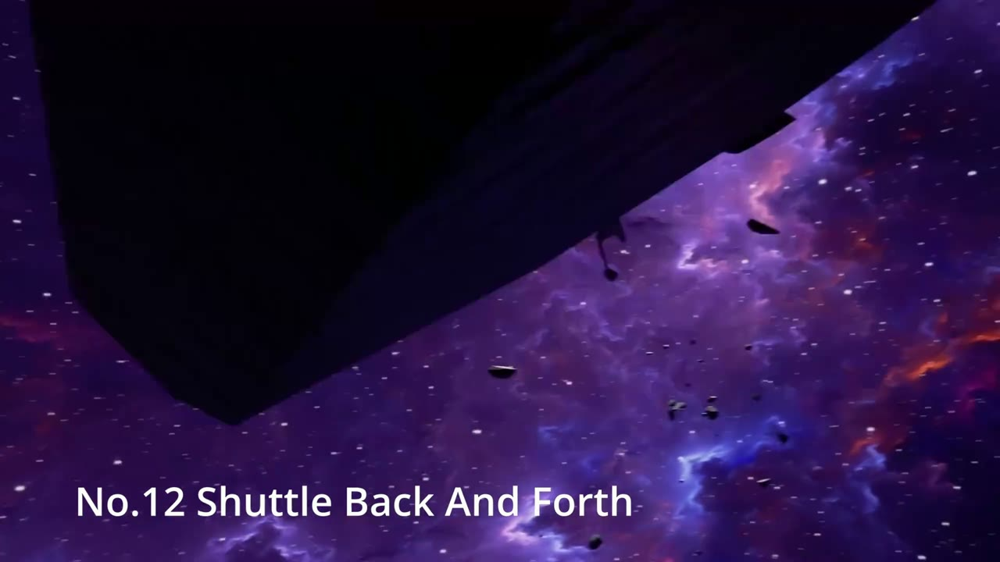 | 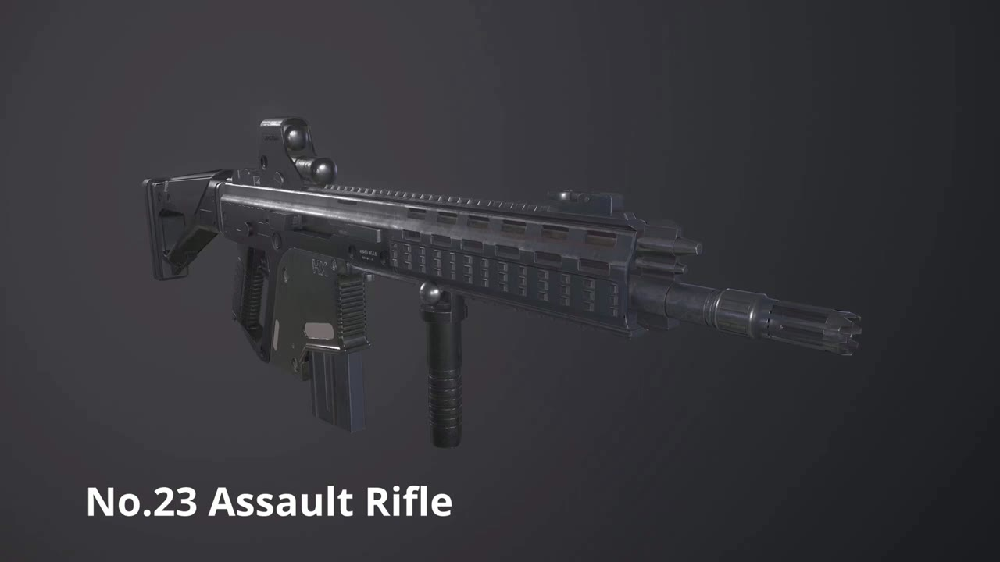 |
| No.15 Motion-captured animation | No.12 Shuttle Back and Forth | No.23 Assault Rifle |
| 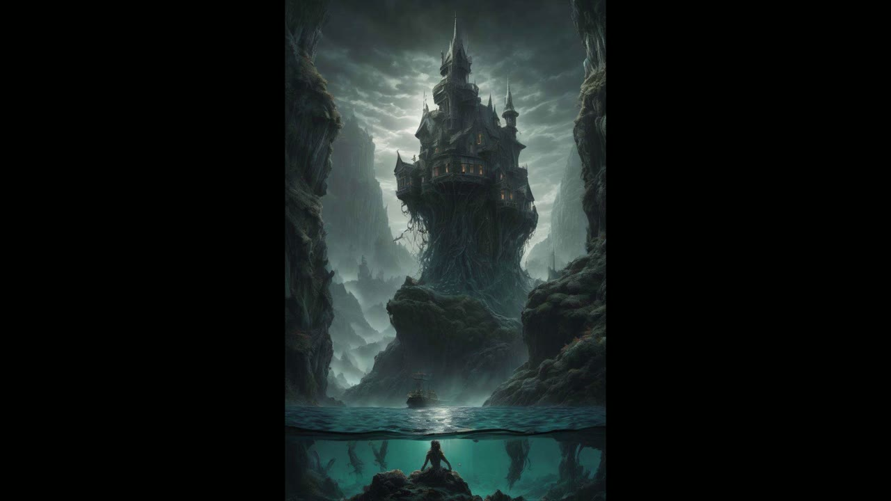 | 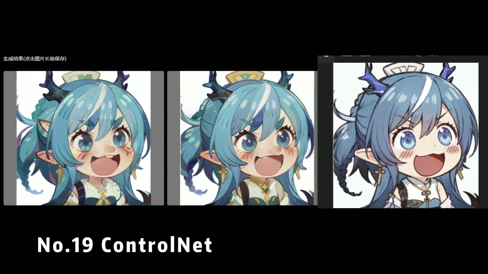 | |
| AI image | No.19 ControlNet | |

## Where it led

This reel is where I started. In the following year I moved from art toward technical art and programming:

- [Little Red: Sequel](https://github.com/Zeeekrom/little-red-sequel) (2024): a story-driven game demo in Unreal Engine 5, where the art skills shown here were used for a whole game.
- [Cyber Finance City](https://github.com/Zeeekrom/cyber-finance-city) (2026): a financial-education game in Unreal Engine 5 with an AI tutor and a VR build.

## Rights and contact

© 2023 3D Art Works 2023. All rights reserved; see [LICENSE](LICENSE). Without written permission, nothing in this repository may be copied, republished or adapted, and the project's code and design may not be rebuilt, whether by hand, with automated tools or with AI cloning tools. The code may not be reverse engineered except where the law allows, and the content may not be scraped, bulk-downloaded or used to train or evaluate AI models. Uses the law already allows, such as fair dealing for review or news reporting, are not affected. Sharing links is welcome. Third-party music, software and AI models used in the reel keep their own licences.

Contact: [LinkedIn](https://www.linkedin.com/in/evan-h-165976301/)
