# 3D 美术作品集 2023

[English](README.md) | **中文**

2023 年 9 月做的一份早期美术作品集视频。当时我在读数字媒体技术专业的专科（上海南湖），用它来投游戏美术岗位。放在这里，是方便想了解我美术背景的人查看。里面不涉及编程。

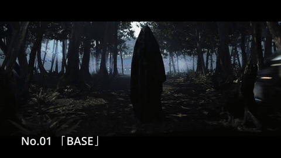

**[观看作品集视频](https://zeeekrom.github.io/3d-art-works-2023/reel/)**（2 分钟，有背景音乐）

## 视频里有什么

编号是视频里显示的编号，来自一份更长的作品清单，视频只选了其中一部分。

| 时间 | 视频中的标题 | 内容 |
|---|---|---|
| 0:03 | No.01 BASE | 昏暗的森林场景 |
| 0:07 | No.02 Lost Lion Civilization | 火光下的遗迹，之后是几段场景镜头：森林里的神社，以及有巨型生物的森林 |
| 0:33 | No.03 Cyberpunk City | 城市场景 |
| 0:35 | No.04 Armed Deerslayer | 持武器的风格化角色 |
| 0:41 | No.05 Full Process of Producing Cartoon Character | 一个卡通角色的全流程制作 |
| 0:47 | No.06 Billboard | 硬表面道具 |
| 0:52 | No.15 Motion Captured Animation (UE5) | 在 Unreal Engine 5 里给角色做的动作捕捉动画 |
| 1:13 | No.12 Shuttle Back and Forth | 太空穿梭效果 |
| 1:17 | No.23 Assault Rifle | 硬表面武器模型 |
| 1:20 | AI 图像 | 用 Stable Diffusion 生成的图像 |
| 1:41 | No.19 ControlNet | Stable Diffusion 加 ControlNet，并排对比不同模型的效果 |

## 截图

| | | |
|---|---|---|
| 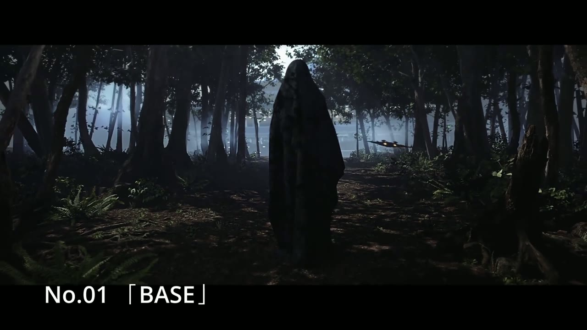 | 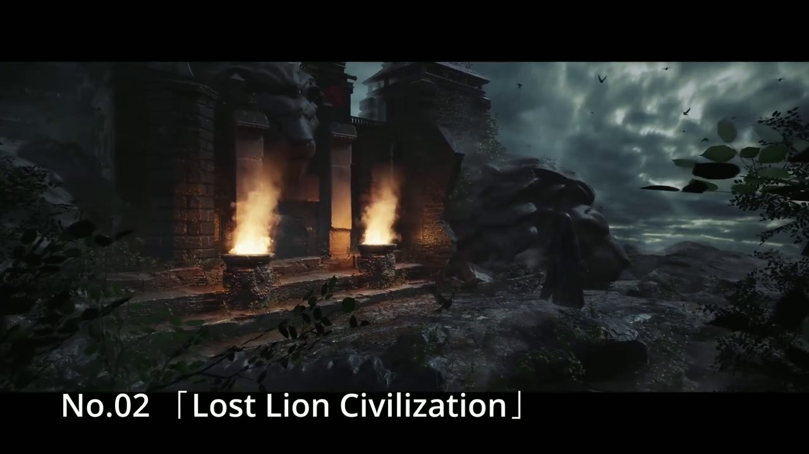 | 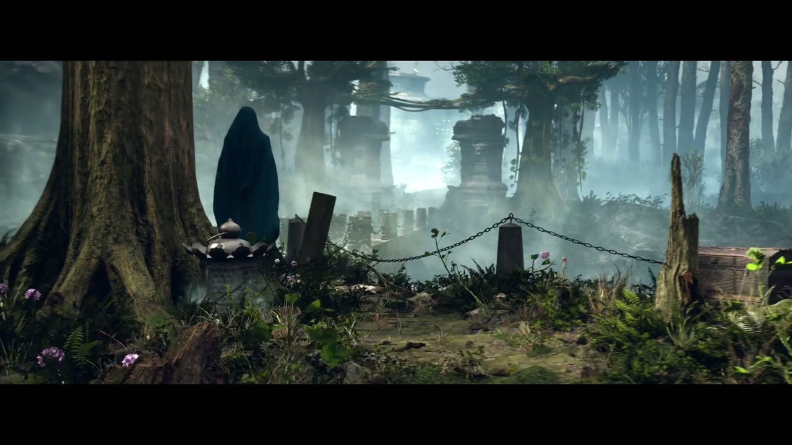 |
| No.01 BASE | No.02 Lost Lion Civilization | 森林神社 |
| 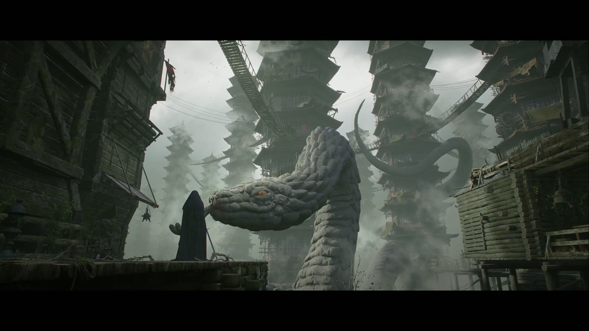 | 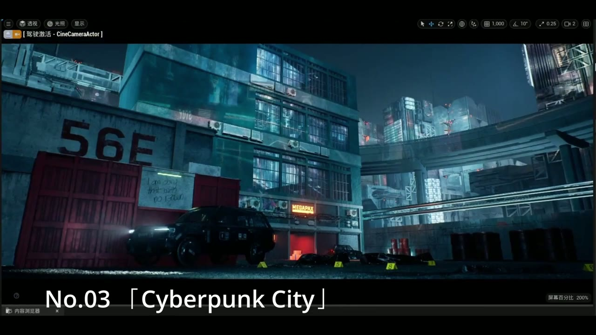 | 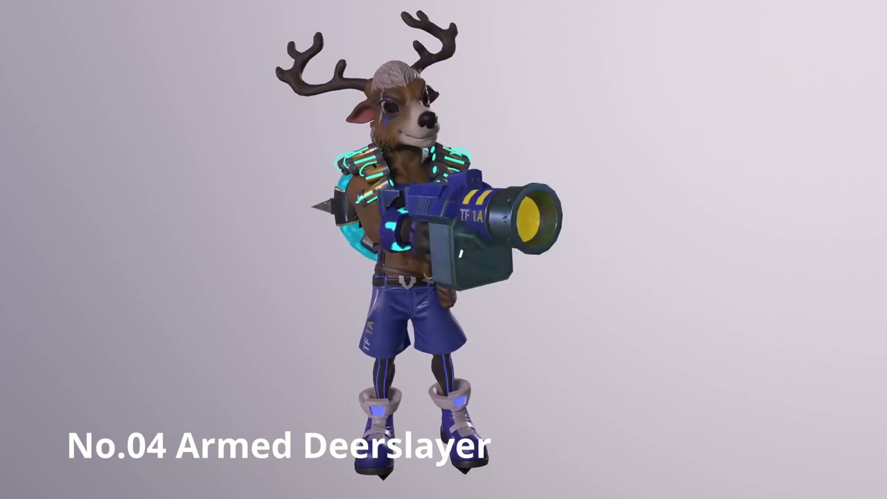 |
| 有巨型生物的森林 | No.03 Cyberpunk City | No.04 Armed Deerslayer |
| 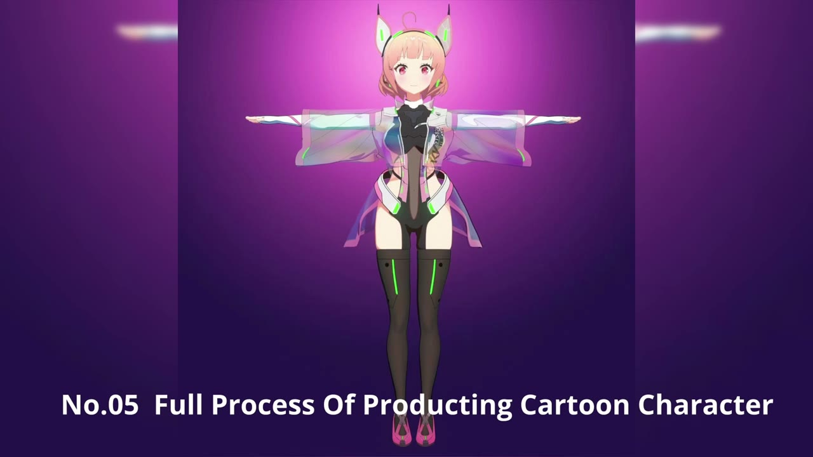 | 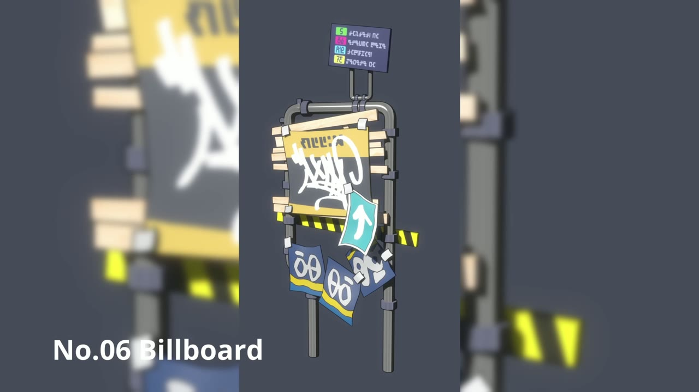 | 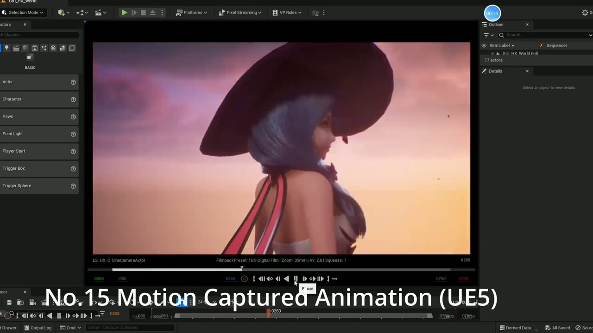 |
| No.05 卡通角色 | No.06 Billboard | No.15 动作捕捉动画 |
| 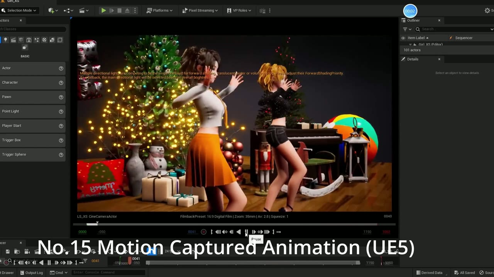 | 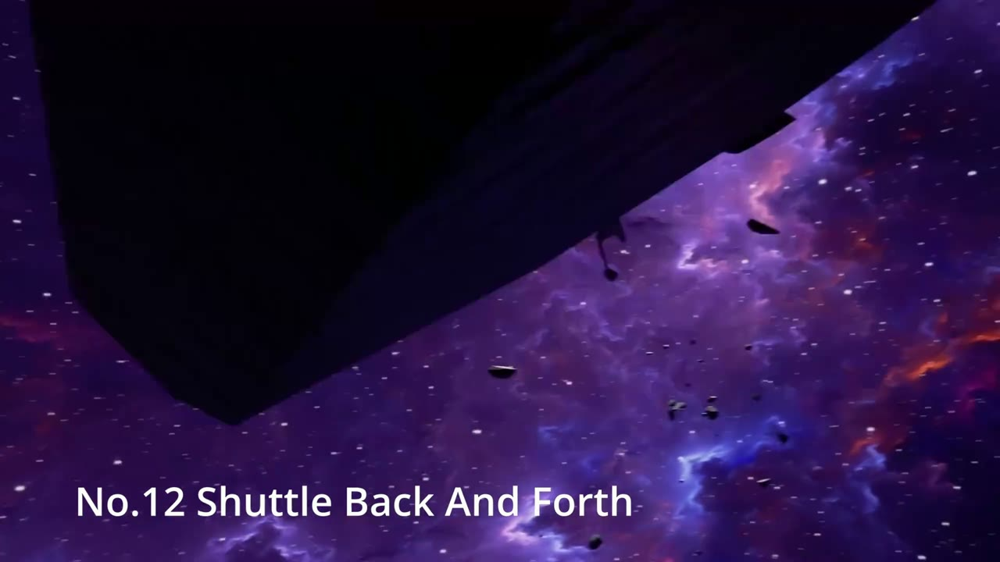 | 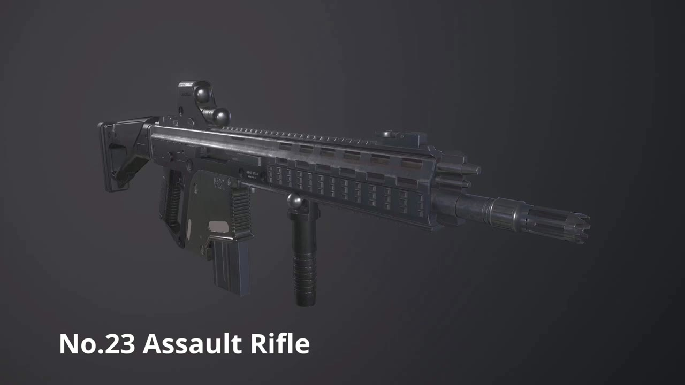 |
| No.15 动作捕捉动画 | No.12 Shuttle Back and Forth | No.23 Assault Rifle |
| 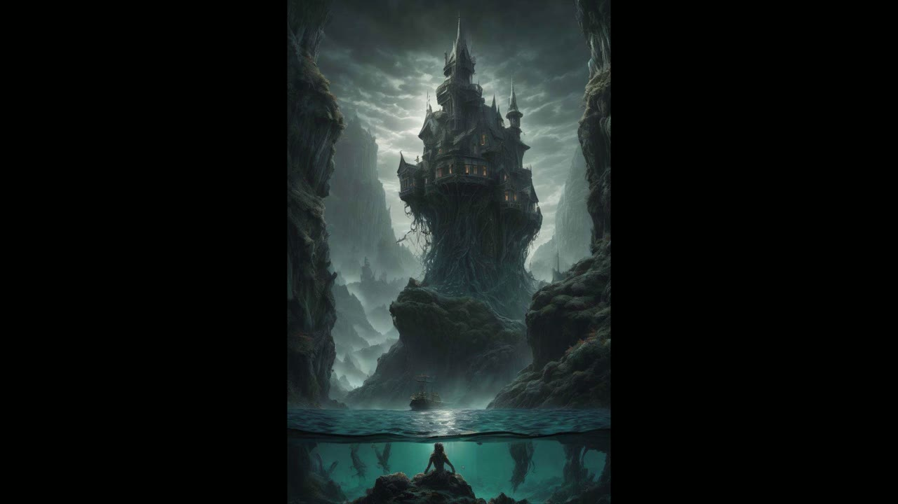 | 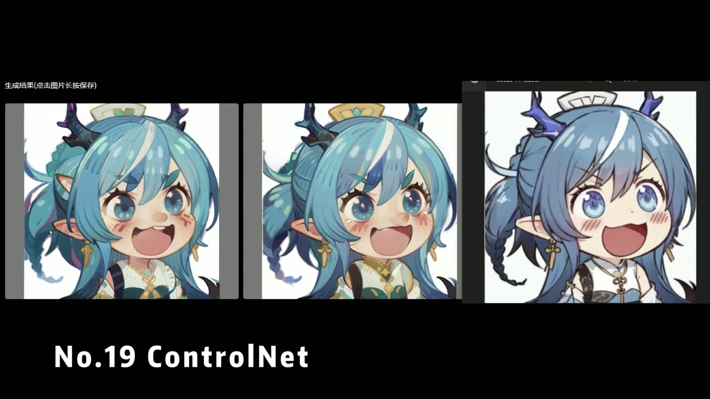 | |
| AI 图像 | No.19 ControlNet | |

## 之后的方向

这份作品集是我的起点。之后一年，我从美术转向技术美术和程序：

- [小红帽：后传](https://github.com/Zeeekrom/little-red-sequel/blob/main/README.zh-CN.md)（2024）：用 Unreal Engine 5 做的叙事向游戏 Demo，这里展示的美术能力被用来完成一整个游戏。
- [赛博金融都市](https://github.com/Zeeekrom/cyber-finance-city/blob/main/README.zh-CN.md)（2026）：用 Unreal Engine 5 做的金融教育游戏，带 AI 导师和 VR 版本。

## 版权与联系

© 2023 3D Art Works 2023，保留所有权利，见 [LICENSE](LICENSE)。未经书面许可，不得复制、转载或改编本仓库的任何内容，也不得用手工、自动化工具或 AI 克隆工具重建项目的代码和设计；除法律允许的情形外，不得对代码进行逆向工程；不得抓取、批量下载这些内容，或把它们用于训练、评测 AI 模型。法律本身允许的使用（如为评论、新闻报道合理引用）不受影响。欢迎分享链接。视频里用到的第三方音乐、软件和 AI 模型保留各自的许可。

联系方式：[LinkedIn](https://www.linkedin.com/in/evan-h-165976301/)
